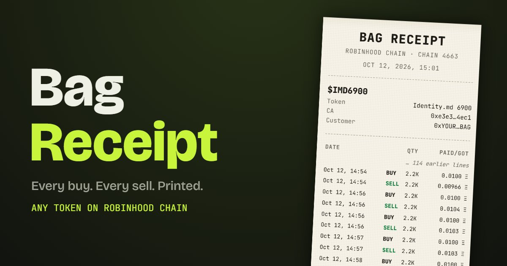

# Bag Receipt

Paste a wallet and a token contract address on **Robinhood Chain**. Get a printed receipt of every buy, every sell, what the bag is worth now, and your total P&L. Save it as an image and post it.

**Live:** https://bag-receipt.vercel.app



## How it works

Everything runs in your browser. No server, no wallet connect, nothing to sign.

1. Reads the token's name, symbol and decimals from the public Robinhood Chain RPC (`rpc.mainnet.chain.robinhood.com`, chain 4663).
2. Pulls every `Transfer` of that token into or out of the wallet with `eth_getLogs`, in 10M-block windows (the RPC's limit), sent as JSON-RPC batches.
3. Prices each transaction from the pool side of the same tx:
   - WETH / USDG flowing into a pool = what a buy cost, flowing out = what a sell paid
   - Uniswap v4 native-ETH pools: the ETH leg of the PoolManager `Swap` event
   - Bonding-curve buys (pons-style): the ETH sent with the transaction
4. Live token price and pool addresses come from DexScreener; ETH/USD from the deepest WETH pair.

P&L = sells + bag value now − buys, all at today's ETH price.

## Limits

- Very active wallets show the latest 150 transactions.
- Transfers that aren't trades (airdrops, sends) show as `IN` / `OUT` with no price.
- Tokens without a DEX market yet count the bag you still hold as $0.

## Run locally

```bash
npx http-server . -p 5317
```

Static files only: `index.html`, `style.css`, `app.js`, `core.js`.

Not financial advice. Not affiliated with Robinhood.
